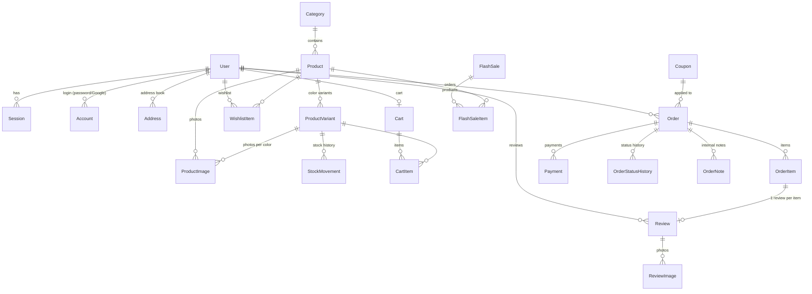

# Zel Shop Database Design

PostgreSQL + Prisma 7. Source of truth: [`prisma/schema.prisma`](../prisma/schema.prisma).
The schema already covers **all four phases** (catalog, cart/checkout, payment/shipping, admin) so later phases don't require large migrations.

**Conventions**
- Money is stored as `Int` Rupiah (no decimals). Weight is in **grams**.
- Order data (address, product name, price) is *snapshotted* into `Order`/`OrderItem` so history doesn't change when products/addresses are edited.
- `soldCount`, `ratingAvg`, and `ratingCount` on `Product` are denormalized for fast sorting; they are updated when an order completes / a review is approved.

## Relationship diagram

## Tables

### Authentication (managed by Better Auth)
| Table | Key contents |
|---|---|
| `user` | name, email (unique), `phone`, **`role`** (`CUSTOMER`, `STAFF` = warehouse staff, `ADMIN`, `OWNER`), `banned` |
| `session` | session token (httpOnly cookie), expiry, IP, user agent |
| `account` | provider (`credential` / `google`); the `password` column holds a **scrypt hash** |
| `verification` | password reset / email verification tokens |
| `rate_limit` | rate-limit counters for login/sign-up/reset (serverless-safe) |

### Catalog
| Table | Key contents |
|---|---|
| `Category` | name, unique `slug` (URL), image, sort order, active |
| `Product` | name, `slug`, description, material, `size` (MINI/SMALL/MEDIUM/LARGE), L×W×H cm, weight, card slots, compartments, `price`, `compareAtPrice` (strikethrough price), visible/hidden, featured, `minStockAlert`, SEO meta |
| `ProductVariant` | color (`colorName`, `colorHex`), **unique SKU**, **stock**, optional override price |
| `ProductImage` | URL (Cloudinary/Supabase), alt, sort order, `isPrimary`, optionally linked to a color variant |
| `StockMovement` | log of every stock change: +/−, balance, reason (`RESTOCK`, `ORDER`, `ORDER_CANCELLED`, …), actor |

### Cart & wishlist
| Table | Key contents |
|---|---|
| `Cart` | owned by a `userId` **or** a `guestToken` (guest cookie). On login, the guest cart is merged into the account cart |
| `CartItem` | variant + quantity, unique per (cart, variant) |
| `WishlistItem` | user + product, notification preferences for discounts / back in stock |
| `Address` | label, recipient, phone, province/city/district/subdistrict, postal code, street, shipping API `areaId`, default |

### Orders & payments
| Table | Key contents |
|---|---|
| `Order` | `orderNumber` (ZEL-YYYYMMDD-XXXX), status (`PENDING_PAYMENT → PAID → PROCESSING → SHIPPED → COMPLETED` / `CANCELLED`), address snapshot, courier & service & ETA, total weight, waybill, subtotal/discount/shipping/shipping discount/total, coupon, payment deadline, timestamp for each status, `accessToken` (guests can view the status without logging in) |
| `OrderItem` | snapshot of name, color, SKU, image, unit price, quantity, weight |
| `OrderStatusHistory` | trail of status changes (by admin or webhook) |
| `OrderNote` | internal admin notes |
| `Payment` | provider (midtrans/xendit), unique `providerRef` (webhook idempotency), method, amount, status, VA/QR/redirect URL, raw payload |

### Reviews
| Table | Key contents |
|---|---|
| `Review` | rating 1–5, text, moderation status (`PENDING`/`APPROVED`/`HIDDEN`), admin reply. **Unique `orderItemId`** → verified buyers only, one review per purchased item |
| `ReviewImage` | review photos |

### Promos & content
| Table | Key contents |
|---|---|
| `Coupon` | unique code, type (`PERCENT`/`FIXED`/`FREE_SHIPPING`), value, max. discount, min. spend, quota & used count, per-user limit, validity period |
| `FlashSale` / `FlashSaleItem` | period, flash price per product, quota & sold count |
| `Banner` | title, subtitle, desktop/mobile image, link, display schedule |
| `Testimonial` | home page testimonials |
| `Page` | About/Policy/FAQ/Contact pages (Markdown, editable by admin) |
| `StoreSettings` | single row: store info, WhatsApp, origin address, active couriers, payment methods, payment deadline, free shipping, social links |

## Stock flow
1. Checkout → in a single transaction: `UPDATE ProductVariant SET stock = stock - n WHERE id = ? AND stock >= n` (prevents *overselling*) + `StockMovement(ORDER)`.
2. Payment expired / cancelled → stock restored + `StockMovement(ORDER_CANCELLED)`.
3. Admin restock → `StockMovement(RESTOCK)` → triggers the "back in stock" wishlist notification.
