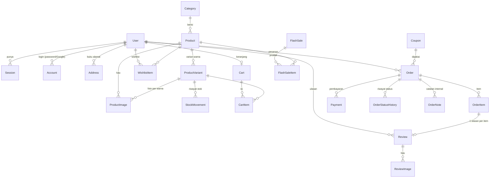

# Rancangan Database Zel Shop

PostgreSQL + Prisma 7. Sumber kebenaran: [`prisma/schema.prisma`](../prisma/schema.prisma).
Skema ini sudah mencakup **keempat tahap** (katalog, keranjang/checkout, pembayaran/ongkir, admin) agar tahap berikutnya tidak memerlukan migrasi besar.

**Konvensi**
- Uang disimpan sebagai `Int` Rupiah (tanpa desimal). Berat dalam **gram**.
- Data pesanan (alamat, nama produk, harga) di-*snapshot* ke `Order`/`OrderItem` supaya riwayat tidak berubah saat produk/alamat diedit.
- `soldCount`, `ratingAvg`, `ratingCount` di `Product` adalah denormalisasi untuk sortir cepat; diperbarui saat pesanan selesai / ulasan disetujui.

## Diagram relasi

## Tabel

### Autentikasi (dikelola Better Auth)
| Tabel | Isi penting |
|---|---|
| `user` | nama, email (unik), `phone`, **`role`** (`CUSTOMER`, `STAFF` = staf gudang, `ADMIN`, `OWNER`), `banned` |
| `session` | token sesi (cookie httpOnly), kedaluwarsa, IP, user agent |
| `account` | provider (`credential` / `google`); kolom `password` berisi **hash scrypt** |
| `verification` | token reset kata sandi / verifikasi email |
| `rate_limit` | penghitung rate-limit login/daftar/reset (aman untuk serverless) |

### Katalog
| Tabel | Isi penting |
|---|---|
| `Category` | nama, `slug` unik (URL), gambar, urutan, aktif |
| `Product` | nama, `slug`, deskripsi, bahan, `size` (MINI/SMALL/MEDIUM/LARGE), P×L×T cm, berat, slot kartu, ruang, `price`, `compareAtPrice` (harga coret), tampil/sembunyi, unggulan, `minStockAlert`, meta SEO |
| `ProductVariant` | warna (`colorName`, `colorHex`), **SKU unik**, **stok**, harga khusus opsional |
| `ProductImage` | URL (Cloudinary/Supabase), alt, urutan, `isPrimary`, opsional terkait varian warna |
| `StockMovement` | log setiap perubahan stok: +/−, saldo, alasan (`RESTOCK`, `ORDER`, `ORDER_CANCELLED`, …), pelaku |

### Keranjang & wishlist
| Tabel | Isi penting |
|---|---|
| `Cart` | milik `userId` **atau** `guestToken` (cookie tamu). Saat login, keranjang tamu digabung ke keranjang akun |
| `CartItem` | varian + jumlah, unik per (cart, varian) |
| `WishlistItem` | user + produk, preferensi notifikasi diskon / stok kembali |
| `Address` | label, penerima, telepon, provinsi/kota/kecamatan/kelurahan, kode pos, jalan, `areaId` API ongkir, default |

### Pesanan & pembayaran
| Tabel | Isi penting |
|---|---|
| `Order` | `orderNumber` (ZEL-YYYYMMDD-XXXX), status (`PENDING_PAYMENT → PAID → PROCESSING → SHIPPED → COMPLETED` / `CANCELLED`), snapshot alamat, kurir & layanan & estimasi, berat total, resi, subtotal/diskon/ongkir/potongan ongkir/total, kupon, batas waktu bayar, cap waktu setiap status, `accessToken` (tamu bisa melihat status tanpa login) |
| `OrderItem` | snapshot nama, warna, SKU, gambar, harga satuan, jumlah, berat |
| `OrderStatusHistory` | jejak perubahan status (oleh admin atau webhook) |
| `OrderNote` | catatan internal admin |
| `Payment` | provider (midtrans/xendit), `providerRef` unik (idempotensi webhook), metode, nominal, status, VA/QR/redirect URL, payload mentah |

### Ulasan
| Tabel | Isi penting |
|---|---|
| `Review` | rating 1–5, teks, status moderasi (`PENDING`/`APPROVED`/`HIDDEN`), balasan admin. **`orderItemId` unik** → hanya pembeli terverifikasi, satu ulasan per item yang dibeli |
| `ReviewImage` | foto ulasan |

### Promo & konten
| Tabel | Isi penting |
|---|---|
| `Coupon` | kode unik, tipe (`PERCENT`/`FIXED`/`FREE_SHIPPING`), nilai, maks. potongan, min. belanja, kuota & terpakai, batas per user, masa berlaku |
| `FlashSale` / `FlashSaleItem` | periode, harga flash per produk, kuota & terjual |
| `Banner` | judul, subjudul, gambar desktop/mobile, tautan, jadwal tayang |
| `Testimonial` | testimoni beranda |
| `Page` | halaman Tentang/Kebijakan/FAQ/Kontak (Markdown, bisa diedit admin) |
| `StoreSettings` | satu baris: info toko, WhatsApp, alamat asal kirim, kurir aktif, metode bayar, batas waktu bayar, gratis ongkir, tautan sosial |

## Alur stok
1. Checkout → dalam satu transaksi: `UPDATE ProductVariant SET stock = stock - n WHERE id = ? AND stock >= n` (mencegah *overselling*) + `StockMovement(ORDER)`.
2. Pembayaran kedaluwarsa / dibatalkan → stok dikembalikan + `StockMovement(ORDER_CANCELLED)`.
3. Restock admin → `StockMovement(RESTOCK)` → memicu notifikasi wishlist "stok kembali".
